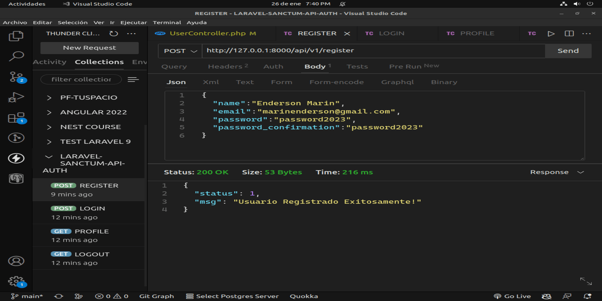
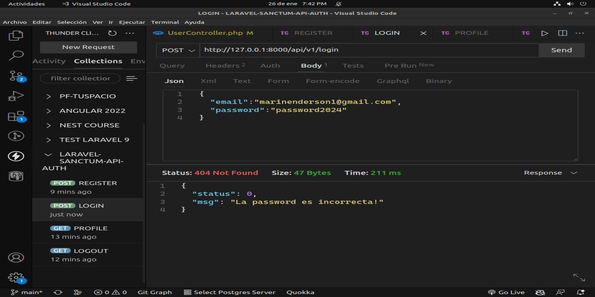
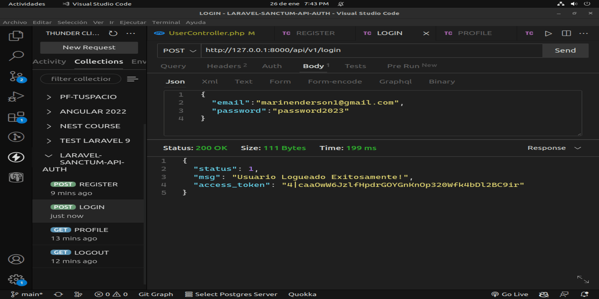
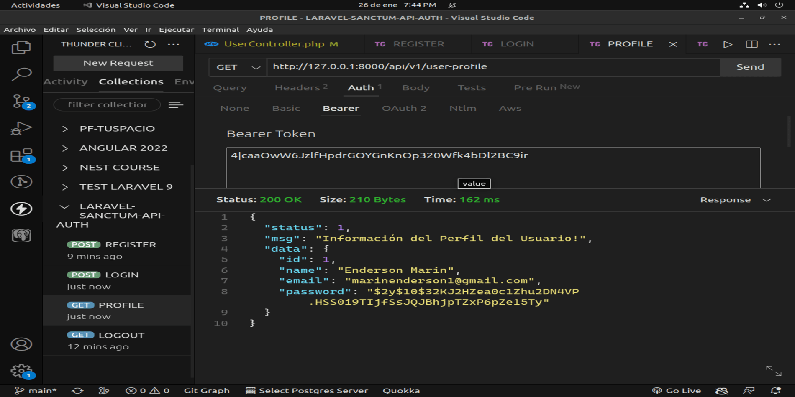
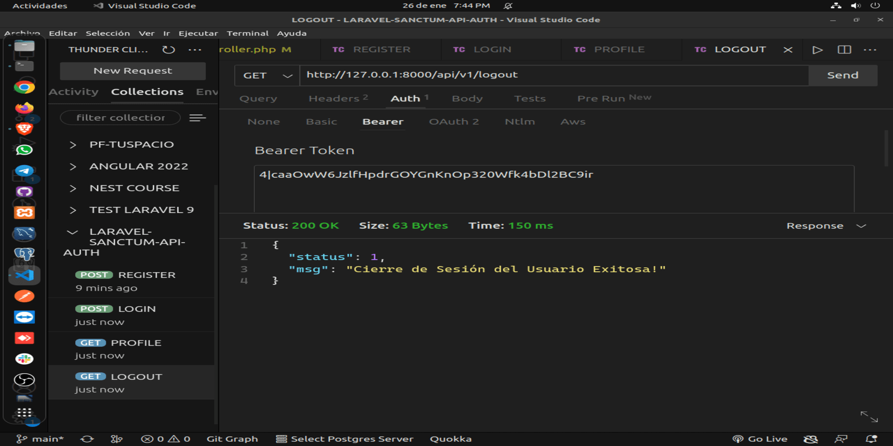
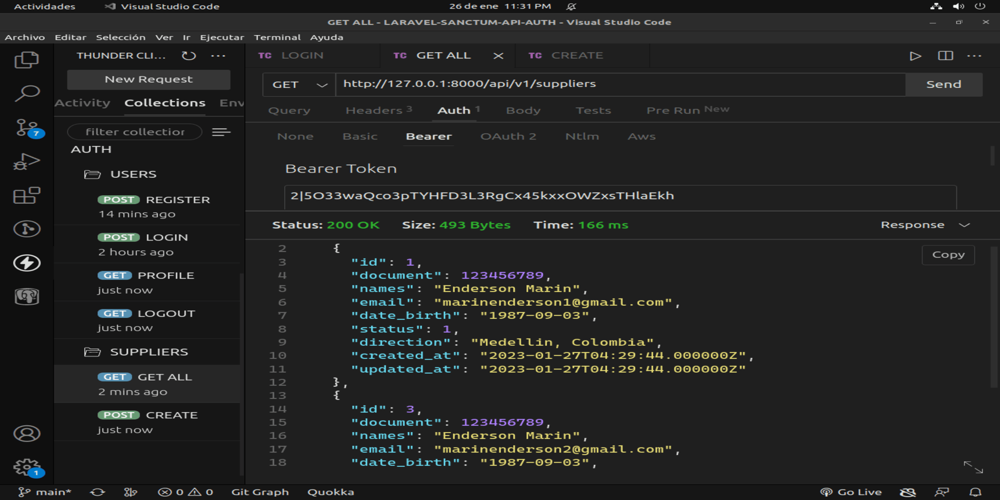
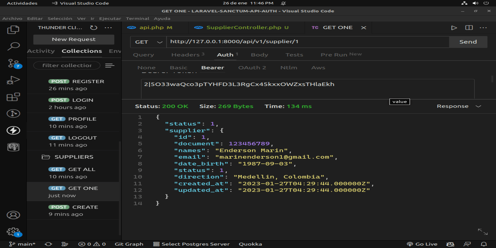
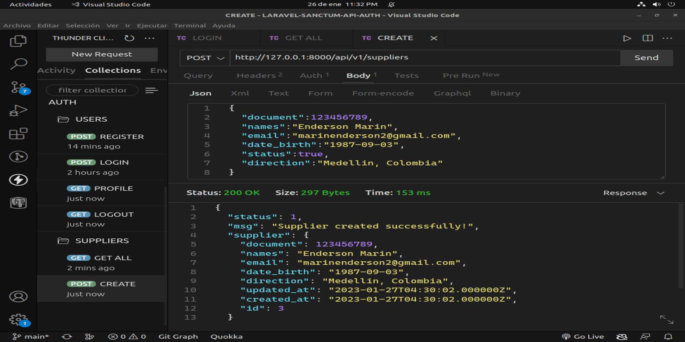
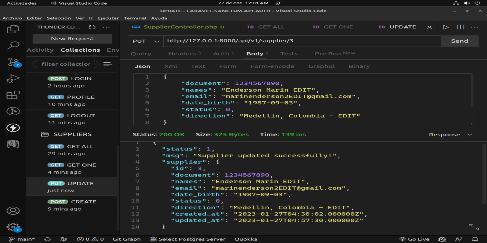
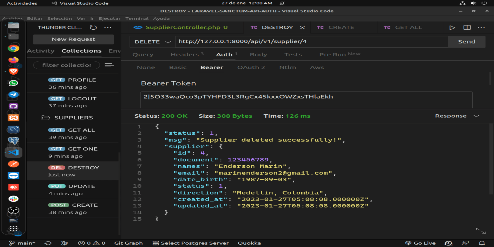

## Título do Projeto

<strong>API RESTful com Laravel</strong>

## Descrição do Projeto

<p style="text-align: justify;">
  Este projeto é uma API RESTful robusta e escalável, construída com PHP e o framework Laravel. Foi projetada para servir como o backend de aplicações web ou móveis, fornecendo um conjunto de endpoints seguros e eficientes para a gestão de dados. O foco está na criação de um sistema de backend modular, fácil de manter e que segue as melhores práticas da indústria.
</p>

## Funcionalidades-Chave:

- Autenticação e Segurança: Implementação de um sistema de autenticação com tokens de API através de Laravel Sanctum. Isso garante que apenas aplicações autorizadas possam aceder aos endpoints protegidos, assegurando a segurança dos dados.

- Comunicação com Serviços Externos: Utiliza o Guzzle HTTP Client para fazer requisições HTTP de forma eficiente, permitindo uma fácil integração com APIs de terceiros.

- Manejo de CORS: Configuração adequada para gerir as políticas de CORS (Cross-Origin Resource Sharing), o que permite que a API seja consumida de forma segura por qualquer frontend, sem restrições de origem.

## Stack Tecnológica:

- Framework de Backend: O núcleo do projeto é o Laravel, um framework PHP reconhecido pela sua sintaxe elegante, alta produtividade e ferramentas poderosas para o desenvolvimento de APIs.

- Autenticação: É utilizado o Laravel Sanctum, um pacote leve que oferece um sistema de autenticação simples e eficaz, ideal para APIs e aplicações de página única.

- Gestão de Dependências: O Composer é responsável pela gestão de todas as bibliotecas e pacotes PHP.

- Ferramentas de Desenvolvimento: O projeto está equipado com ferramentas de vanguarda, como PHPUnit para testes unitários e FakerPHP para a geração de dados de teste, garantindo um desenvolvimento de alta qualidade e uma cobertura de testes sólida.

- Compilação de Assets: Embora seja um projeto de backend, inclui o Laravel Mix para a compilação de ativos de frontend, como CSS e JavaScript, se necessário.


## Capturas de Tela

<div style="overflow-x: auto;">
    <table style="width: 100%;">
        <tr>
            <td style="width: 50%;"></td>
            <td style="width: 50%;"></td>
        </tr>
        <tr>
            <td style="width: 50%;"></td>
            <td style="width: 50%;"></td>
        </tr>
        <tr>
            <td style="width: 50%;"></td>
            <td style="width: 50%;"></td>
        </tr>
        <tr>
            <td style="width: 50%;"></td>
            <td style="width: 50%;"></td>
        </tr>
        <tr>
            <td style="width: 50%;"></td>
            <td style="width: 50%;"></td>
        </tr>
        <tr>
            <td style="width: 50%;"></td>
        </tr>
    </table>
</div>

## Começando

### Pré-requisitos

Você precisa instalar o seguinte software

1.  NODEJS(VERSION: 20.10.0)
2.  NPM(VERSION: 10.2.3)
3.  GIT

### A maneira mais fácil para começar é clonar o repositório:

git clone [https://github.com/ENDERSON-MARIN/LARAVEL9-SANCTUM-API](https://github.com/ENDERSON-MARIN/LARAVEL9-SANCTUM-API)

### Mude o diretório e abra no editor de texto

- cd your-project-directory
- open in your text editor

### Configure suas variáveis de ambiente (Clone o arquivo .env.template e renomeie para .env)

- DB_CONNECTION=your_connection_database
- DB_HOST=your_host_database
- DB_PORT=your_port_database
- DB_DATABASE=your_database_name
- DB_USERNAME=your_username_database
- DB_PASSWORD=your_password_database

### Inicie seu aplicativo de forma muito simples

- Start the project in development mode

```
php artisan serve --port 8000
```

- Você pode verificar que o site estará funcionando em localhost
  http://localhost:8000

## Autor

- [Enderson Marín](https://www.marinenderson.com)

## Meu contato:

- 📧 Email: marinenderson1@gmail.com
- 🐱 GitHub: https://github.com/ENDERSON-MARIN
- 🌐 Portfolio: https://portfolio-ecmm.vercel.app/
- 💼 LinkedIn: https://www.linkedin.com/in/enderson-marin

## Vídeos de Demonstração

- Você pode verificar um vídeo de demonstração do meu projeto no seguinte canal:

  https://www.youtube.com/channel/UCDIIj706aFneZlfVJucVkhA

## Licença

Este projeto está licenciado sob a Licença MIT - consulte o arquivo [LICENSE.md](LICENSE.md) para obter detalhes
